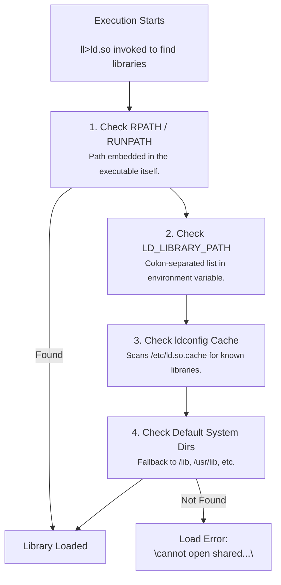

# Setting up development environment

> The dev environment MUST:
> - Be hermetic.
> - Works on all supported OS/ARCH combinations.
> - Have readable setup script and use as little dependencies as possible.
>   Prefer to copy the source & add a comment to reference, instead of
>   importing. This allow for full inspection on what goes into the setup.
>   It also make it easier for new Nix users to read.

Usage:

```
$> nix develop
$(dev-shell)> # Run commands inside the dev env
```

***

# Learnings

- Because we need to render graphics, we need to pull in the system's libraries
  for calling graphics API.
  - On MacOS, there is a single target: Metal.
  - On Linux, the libs are implicitly searched from /usr/lib. Actual lib used
    depends on the GPU (NVIDIA, AMD, Intel). No two machines are the same.
    Typically the lib search is done at **runtime** (so it find whatever on
    the machine). We can also set LD_LIBRARY_PATH to point the search to the
    right place.
  - On Windows, the equivalent is probably: DirectX.
- There are 3 different ways to run code from a library:
  - static linking: baking the library code into the binary
  - dynamic linking: updating the binary, such that it loads `ld.so`, specify
    some data in the binary (e.g. in ELF format) such that the dynamic linker
    loads the shared library before the program run.
  - runtime load: the binary search for and load the dynamic libraries by itself
    at runtime. This is generally recommended for libraries that are dependent
    on drivers.
- Extrapolate from this knowledge, we can guess how Steam / other installers
  distribute binaries for different platforms: package the game binary, game
  dynamic libraries (`*.so`/`*.dylib`/`*.dll`) for graphics, sound, input, etc.

# Static Linking vs Dynamic Linking vs Runtime Loading

> disclaimer: from LLMs

|                         |     Static linking      | Dynamic linking (load-time) |       Runtime loading (dlopen)       |
|-------------------------|-------------------------|-----------------------------|--------------------------------------|
| Code lives              | copied into your binary | in libfoo.so on the system  | in libfoo.so on the system           |
| Who resolves it         | ld at build time        | ld.so at process startup    | your own code, whenever it decides   |
| Recorded in the ELF     | nothing                 | DT_NEEDED entry             | nothing — just a string in .rodata   |
| Visible to ldd/patchelf | n/a                     | yes                         | no                                   |
| If missing              | can't happen            | process dies before main()  | you get a NULL/Err and can fall back |
| Symbol access           | direct call             | direct call, via PLT/GOT    | dlsym() → function pointer           |
| Granularity             | all-or-nothing          | all-or-nothing              | per-library, per-symbol, conditional |

# Searching for dynamic-linked libraries



# To verify
- Does setting LD_LIBRARY_PATH fully enable the build to run on any machine?
- Are we actually able to make a no-dependency build? If so, building inside
  a scratch container, then bringing the binary to run on any linux/mac machine
  should work.

***

# References

- https://discourse.nixos.org/t/unable-to-find-gpu/19818
- https://github.com/bevyengine/bevy/blob/main/docs/linux_dependencies.md#nix
- https://vulkan.lunarg.com/doc/sdk/1.4.363.0/linux/LoaderApplicationInterface.html
- https://docs.rs/wayland-backend/latest/wayland_backend/
- https://github.com/ash-rs/ash#optional-linking
- https://nixos.org/manual/nixpkgs/stable/#setup-hook-autopatchelf
- https://github.com/nix-community/nix-ld
- https://stackoverflow.com/questions/67131565/how-do-i-set-dt-rpath-or-dt-runpath
- https://linuxjunkies.org/glossary/ld-so
- https://en.wikipedia.org/wiki/Comparison_of_executable_file_formats
- https://web.archive.org/web/20120418232524/http://labs.qt.nokia.com/2011/10/28/rpath-and-runpath/
- https://circuitlabs.net/shared-libs-linking-ld_library_path-rpath-ldconfig/
- `man ld.so`


## Why Bevy/winit dlopen() some Linux libraries instead of linking them at compile time

Let's build this up from scratch.

### 1. Why a program needs outside libraries at all

Your game needs to do things the CPU can't do alone: draw pixels on a GPU, read a keyboard layout, open a window, play sound. The code for "how to talk to a Wayland window" or "how to talk to a Vulkan graphics driver" is huge and system-specific, so nobody rewrites it — it lives in shared library files (`.so` files) that the OS/distro already has sitting around, and your program borrows them.

"Borrowing" a library means: somewhere, your program needs to know *where that code is* so it can jump into it.

### 2. Two ways to find that location: at compile time, or at run time

Think of it like looking up a phone number.

- **Compile-time linking** ("the recipe card already has the number written on it"): when your program is built, the linker writes down "I need `libasound.so`, and here's effectively where to find it." At build time, the toolchain checks the library exists and bakes the connection in. This is simple and fast, but it means the library *must* exist, with that exact name, wherever your program runs — or it refuses to even start.

- **Runtime loading, i.e. `dlopen`** ("look up the number in the phone book while you're mid-call"): instead of baking in "I need this," the program carries code that says, *while running*, "go search for a library with this name, and if you find it, use it — if not, fall back to something else or skip that feature." The decision of whether/which library to use happens live, not at build time.

### 3. Why would anyone choose the second, more complicated option?

Because Linux desktops are not uniform. One machine runs Wayland, another runs X11. One has an Nvidia Vulkan driver, another has none. If winit/Bevy *hard-required* (compile-time-linked) every one of these, the binary would refuse to launch on any machine missing even one of them — e.g. a laptop with no Wayland installed would make the whole game crash immediately, even though it could've just used X11 instead.

So the authors of `winit` (window handling) and `wgpu`/`ash` (graphics) made a deliberate choice: for the pieces that vary a lot across systems — Wayland libraries, the keyboard-layout library (`xkbcommon`), the Vulkan driver loader, the EGL graphics-context loader — probe for them *at runtime*, and gracefully use whichever ones are actually present. That's exactly standard practice even outside Rust; the Vulkan spec itself expects apps to `dlopen` the loader for this reason.

By contrast, things like the ALSA sound library and `udev` (device info) are treated as safe bets that are essentially always present on any real Linux desktop, so those just get normal compile-time linking — simpler, no downside.

### 4. Where Nix comes into this

Normally, both kinds of libraries live in a predictable spot like `/usr/lib`, so the OS always knows where to look.

Nix doesn't do that — it installs every library into its own private, oddly-named folder (content-hashed, like `/nix/store/abc123-wayland-1.22/lib`). That's fine for the compile-time-linked libraries, because Nix's build tooling *saw* the program ask for them by name during the build, so it can stamp the exact store path directly into the compiled binary automatically.

But for the `dlopen`'d ones, nothing in the build process ever "sees" the request — it's just a string like `"libwayland-client.so"` buried in code logic that only gets used while running. Nix's tooling has no hook into that, so it can't auto-fix the path. You have to do it by hand: tell the OS's library search path (`LD_LIBRARY_PATH`) to include those Nix store folders yourself, so when the program says "go search for `libwayland-client.so`" at runtime, the search actually finds it.

That's exactly what the `shellHook` in `flake.nix` is doing — manually pointing the runtime library search path at the Nix store locations for the handful of libraries that Bevy/winit only look up live, rather than bake in at build time.
